# Swarm panel redesign (board #39)

Status: **built** (board #40 the rights and away, #41 state and the new commands, #42 the panel). §8 is what the
user approved and overrides the text above it; the answer field on a waiting task is not built. Every shot below is
this checkout's panel in a private Herdr on a made-up swarm (`demo.sh`), from `shot.sh`; `shots/redesign/` holds each
screen at 420, 520 and 860px, dark and light (`<screen>-<width>[-light].png`).

Before, for comparison: [the current first screen](shots/redesign/before-home-520.png).

## 1. What goes first, and why

The panel is glanced at, not read. A glance should answer three questions, in this order:

| # | Question | On Home | Why it ranks here |
|---|---|---|---|
| 1 | Does anything need me? | **Needs you**: each open question in full, a red main, a hung agent, a machine out of memory. One calm line when there is nothing. | It is the only part that costs the swarm time while you don't look. |
| 2 | Who is running, and on what? | **Agents**: one row each: status dot, name, its task (or what it waits for), state. | It tells you the swarm is alive and what to expect next. |
| 3 | How much is left? | **Tasks**: a done bar, then the tasks still open, most urgent first; links to done and dropped. | It is the progress answer; details are one click away. |

Below those, the one thing you act on rather than read: **Staffing** (the two numbers, with − and +).
The **Away** switch and the nav bar are on every screen.

Moved off the first screen, to the screen where it is useful:

| Was on the first screen | Now |
|---|---|
| Model, cache state, context bar, last event, role chip per agent | The agent's screen. Home keeps only a warning chip (hung, no waiter, context full). |
| Header chips (live, working, claimed, blocked, done counts) | Gone: the Agents and Tasks section titles carry the two counts that matter. |
| Board card with five state counts and "latest done" | Tasks list on Home; the Board screen for everything. |
| Activity feed | More › Activity. |
| Machine footer, CI runs, PRs, locks, command cost, memory per agent | More › System. A problem there surfaces in Needs you. |
| Five tabs (Overview, Agents, Board, Activity, System) | A nav bar of four: Home, Agents, Board, More. |
| "idle 31m" on an agent, with no reason | "idle 31m: uncommitted work": the first reason watchd keeps it (§2). |

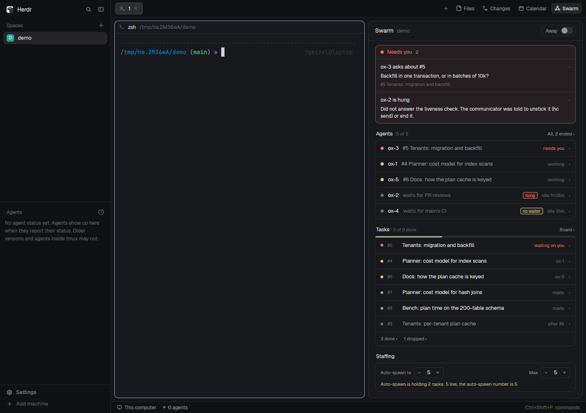

From 760px Home is two columns; in light themes it uses the same theme colors:

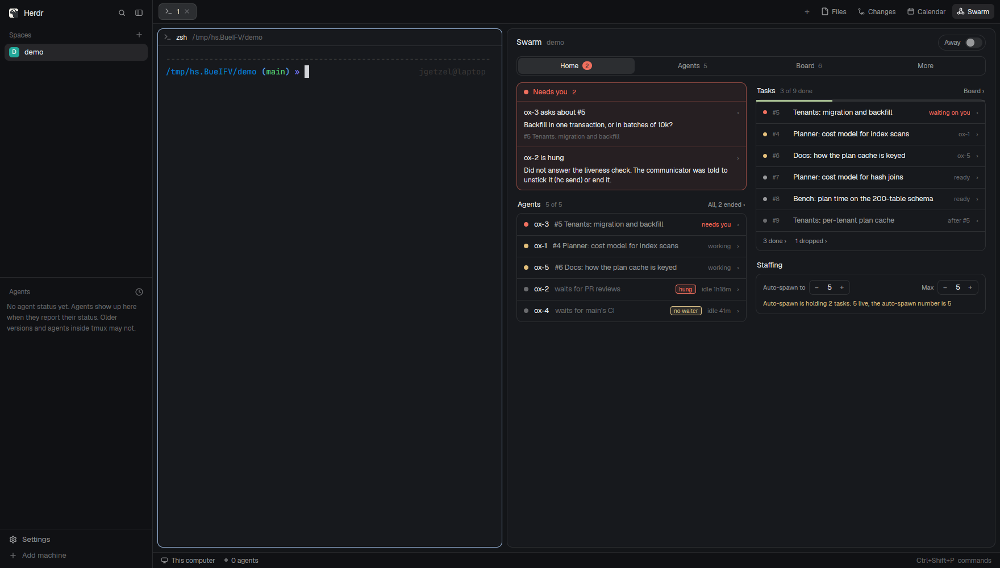
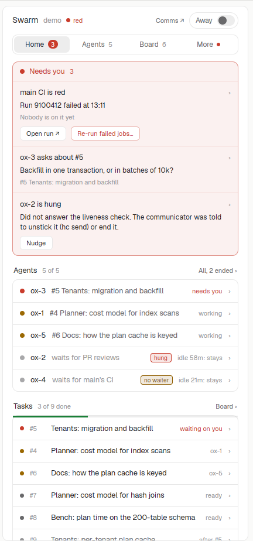
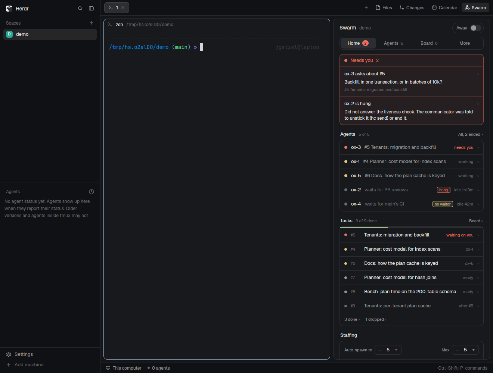

## 2. Screens

### The nav bar

**Home · Agents · Board · More**, under the header of every screen.

- The section of the shown screen is marked, and the mark slides to the one you pick. A task counts
  as Board, an agent as Agents, wherever you opened it from.
- Badges: Home carries a red count of what needs you (so it is visible from any screen), Agents the
  number running, Board the tasks left, More a red dot when System has a problem.
- A task or an agent opens on top of the screen you picked it on. Those screens get a back row under
  the bar, named after where back goes ("‹ Board", "‹ Home", "‹ Task #5"). Picking a section in the
  bar always goes to that section's own screen and forgets the trail.
- Width: four equal segments of the panel's width. At 420px each is 95px, enough for the label and
  its count (shot above). At 340px and below the counts are dropped and the labels stay; the red Home
  badge and the More dot stay at every width.

```
Home    ── Needs you, Agents, Tasks, Staffing
Agents  ── running, the communicator, ended ──► Agent
Board   ── Active | Done | Dropped ───────────► Task
More    ── Activity (Summary | Full log, filters) | System
Task  ──► its owner (Agent), tasks it waits on or holds back (Task), its PR (browser)
Agent ──► its task and finished tasks (Task), its terminal (Herdr focus), its PR (browser)
```

**Task.** State, title, actions; the question when it waits on you; owner and lease, who added it,
what it waits on and holds back, time queued/worked/blocked, claims and releases, model and base,
evidence with PR, commit and CI result; the description (markdown); messages that name it; its history.

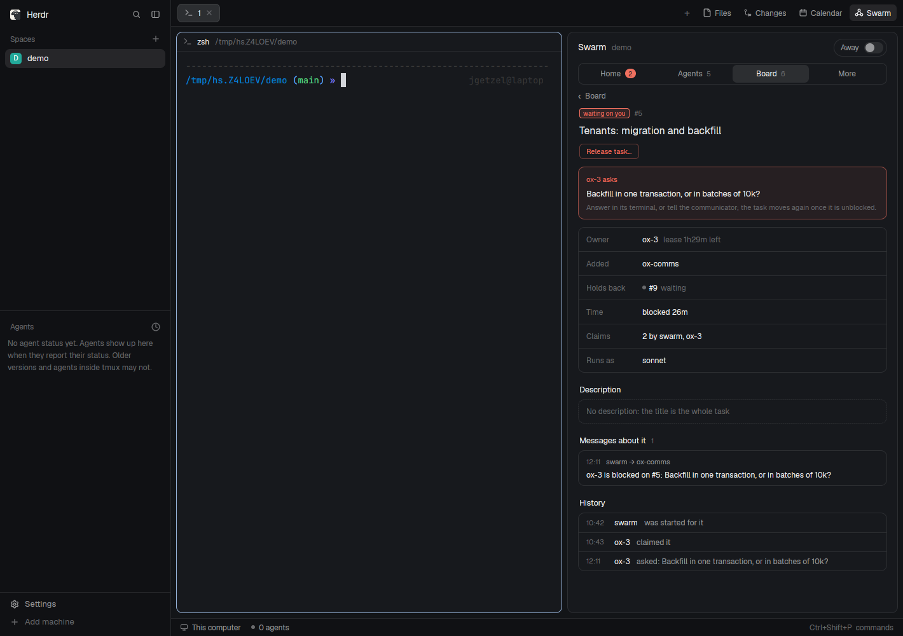
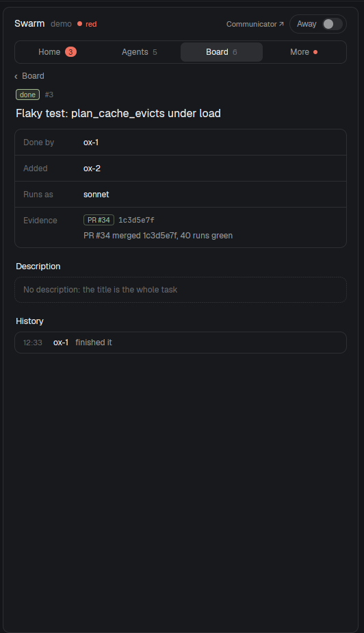
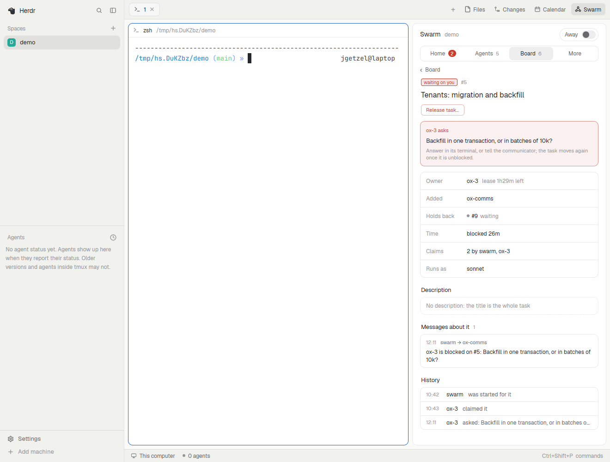

**Agent.** State, role, actions; a hung/no-waiter warning in words; its task; what it waits for,
model, context against the 350k and 550k marks, cache, branch, PR; files it is editing; messages;
tasks it finished; latest events. Ended agents open the same screen, without actions.

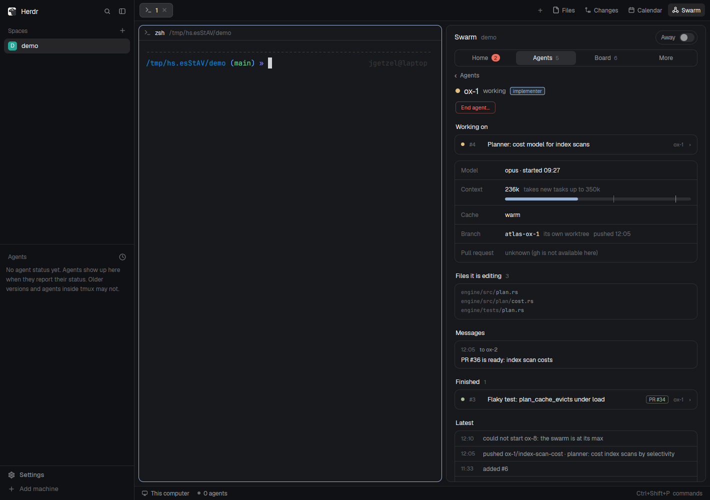
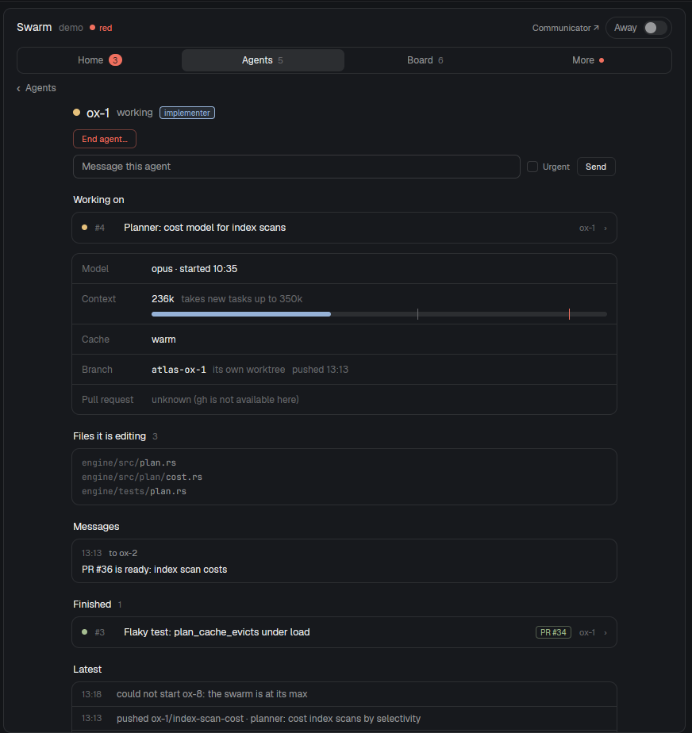
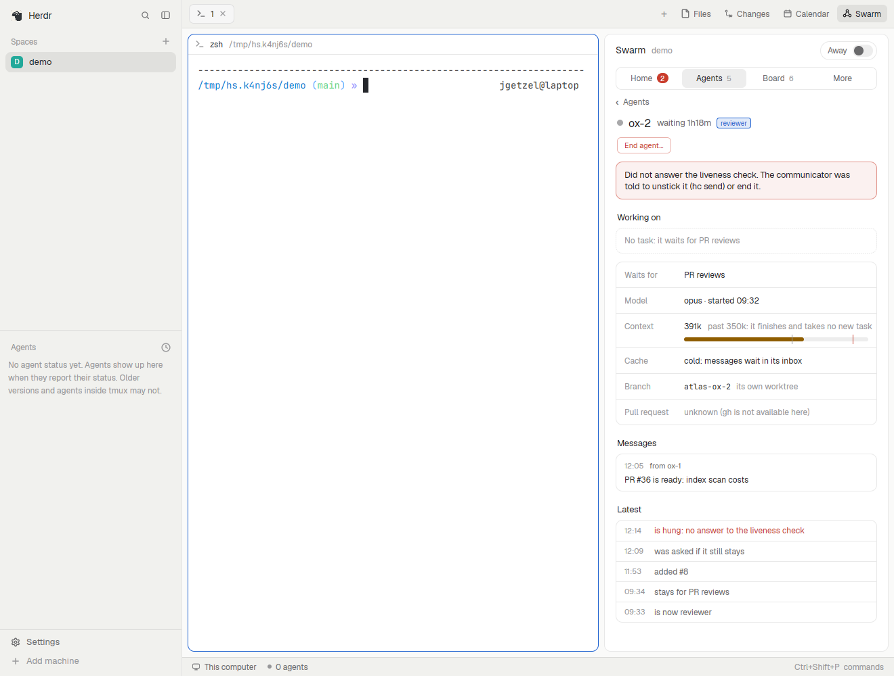

**Why an idle agent is still here.** On the Agent screen of an idle agent: the conclusion in words,
then one line per check, lit when that check is what keeps it. The shot uses sample data; the real
lines come from the CLI.

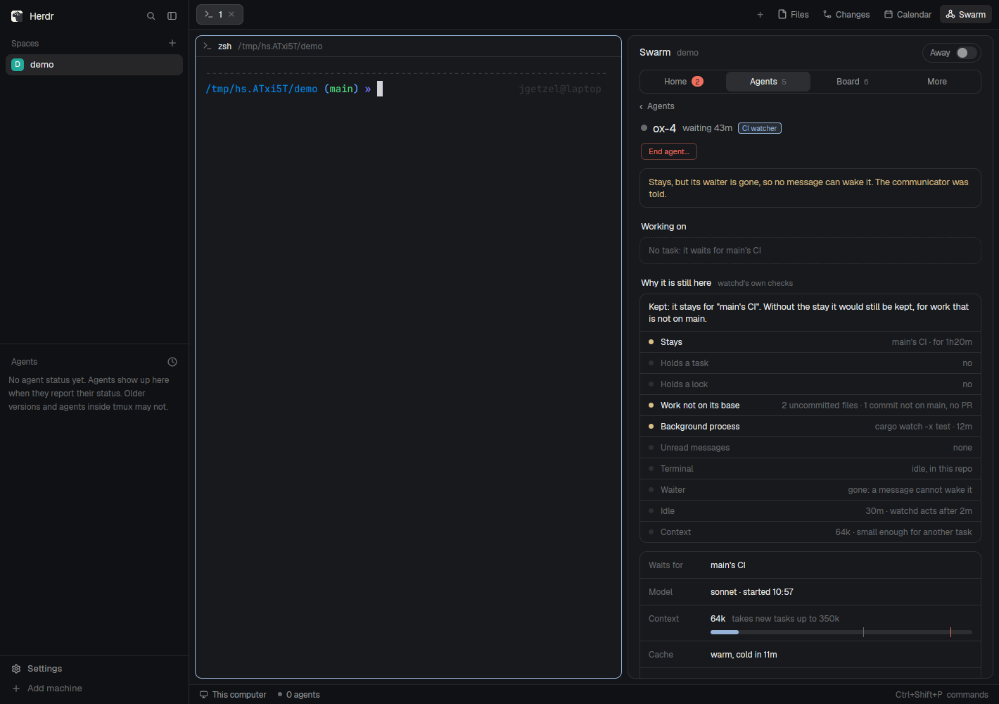

The panel does not work this out. `swarm state --json` gains a `fate` object per live idle agent, filled
by the function watchd itself decides with (`watchd.fate`, and the checks of `swarm end`):

| Line | From | Detail shown |
|---|---|---|
| Stays | the agent's `stay` | its text, how long |
| Holds a task | claimed or blocked tasks | which, lease left |
| Holds a lock | its locks | the paths |
| Work not on its base | `watchd.unlanded` | uncommitted files (count), commits not on the base (count, PR if any) |
| Background process | `machine.bg_agents` | the command, how long |
| Unread messages | its inbox | how many, urgent or not |
| Terminal | hc | busy, idle, gone, or in another repo |
| Waiter | its waiter pid | present, or gone (no message can wake it) |
| Idle | last activity | how long, against watchd's 2 minutes |
| Context | context size, the task pool | small enough to be given another task, or not |

`fate.verdict` is watchd's own word (kept, unclean, reuse, end) and `fate.says` the sentence: "watchd
ends it at its next tick", "Kept: 2 uncommitted files and a running shell", "Kept for reuse: #7 is
ready". `fate.short` is the Home chip ("uncommitted work"). The agent's screen asks for every check;
Home asks only for the first one that holds, which is what watchd already computes each tick.

**Agents** and **Board** are the past-items screens: ended agents, done and dropped tasks.

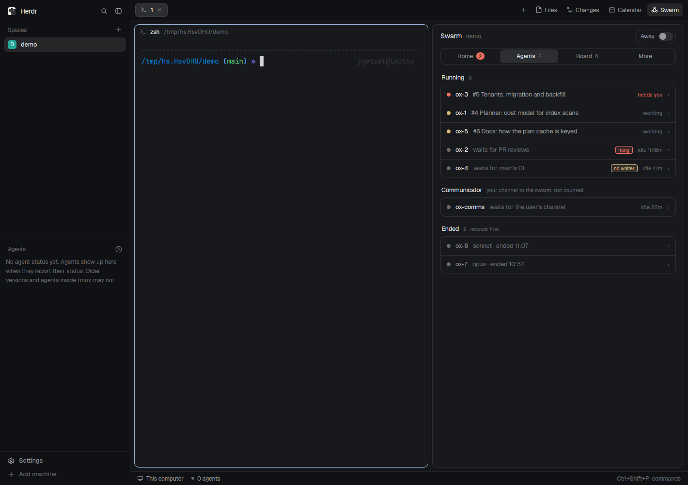
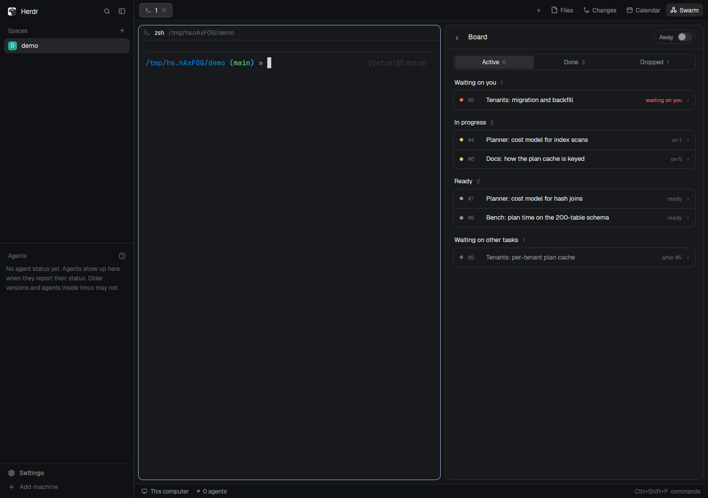
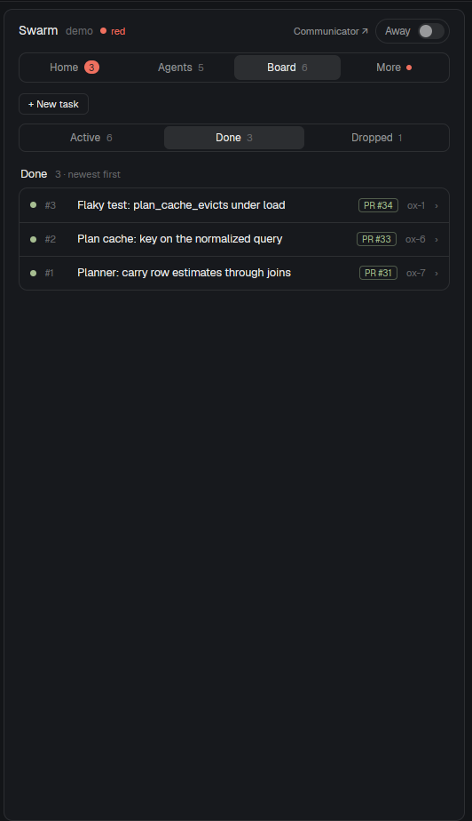

**More** keeps today's Activity and System tabs whole. In the build they get the new type scale and
spacing; their content does not change.

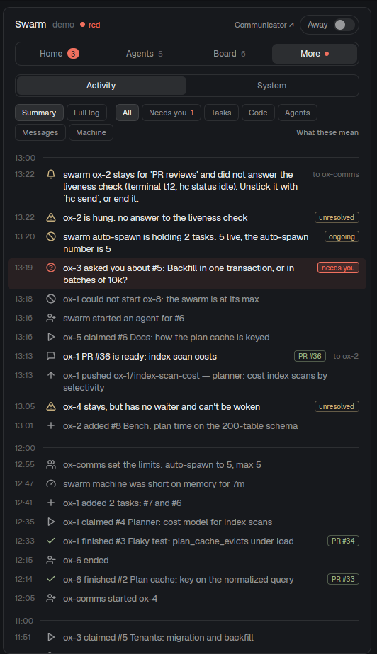
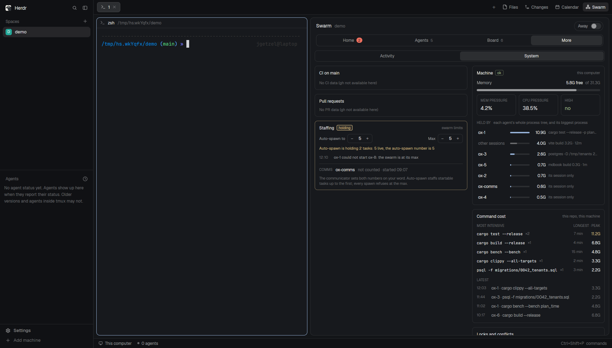

## 3. Actions

Every action runs the `swarm` CLI; the panel never writes the db. What the command prints, or the text
of its refusal, shows in a bar at the top of the screen until dismissed.

| Control | Where | Command | Confirmation |
|---|---|---|---|
| Away switch | header, every screen | `swarm away` / `swarm away --back` | none (undo is one click) |
| Auto-spawn to − / + | Home › Staffing, System | `swarm limits --min N` | none |
| Max − / + | Home › Staffing, System | `swarm limits --max N` | none |
| Release task… | Task, while claimed or blocked | `swarm task release N` | "Release #N from ox-1?" |
| End agent… | Agent, while live | `swarm end NAME` | "End ox-3?" |
| End anyway… | the refusal bar, after `end` refused | `swarm end NAME --force` | "End ox-3 anyway?" (a second one) |
| Open terminal ↗ | Agent, Task | Herdr `agent.focus` | none |
| PR #N ↗ | Task, Agent | `gh pr view N --web` | none |

"Kill" is `End anyway`: `swarm end` first runs its checks (working, holds a task or lock, a background
job, work not on its base) and says which one failed; only then is the forced end offered, behind its
own confirmation. Confirmations use Herdr's own confirm dialog (Enter confirms, Esc cancels).

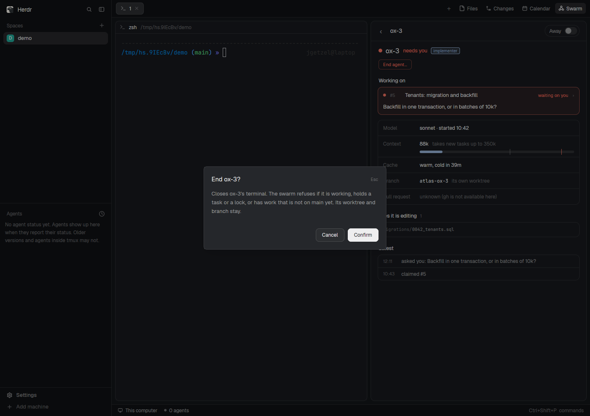
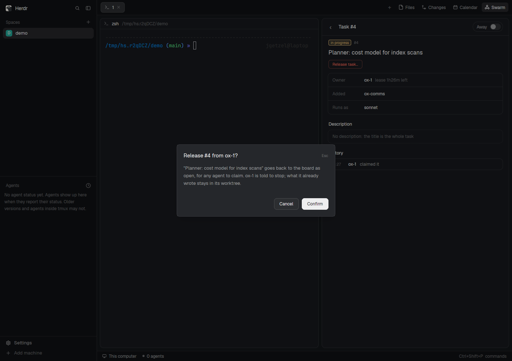
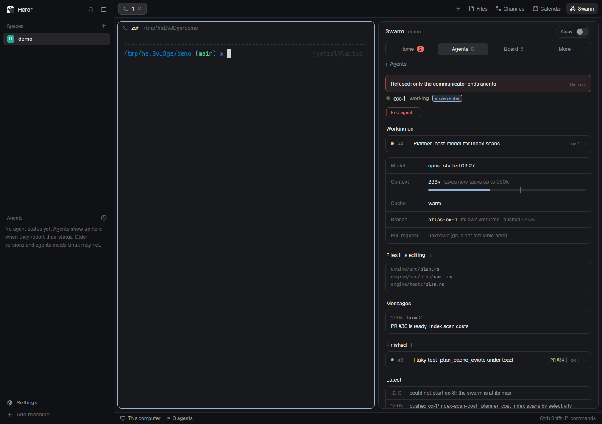

## 3b. More actions: what I would add, and what I would leave out

Text fields (answer, message, new task) are a single input with a Send button; Enter sends, Esc clears.

| Action | Verdict | Where | Command | Confirmation |
|---|---|---|---|---|
| Answer a waiting task | **Add.** It is the one thing Needs you asks of you. | the question card on Task | `swarm task unblock N --answer "…"` | none; Send is deliberate |
| Nudge an agent | **Add.** Shown on an agent that is hung, or idle while holding a task. | Agent; the hung item in Needs you | new `swarm nudge NAME`: sends its terminal one fixed line ("read your messages and continue, or say what you wait for") through hc and logs it | none; the button rests for a minute after use |
| Message an agent | **Add.** | Agent | `swarm post NAME "…"`, with an Urgent tick that adds `--urgent` | none |
| Message @all | **Leave out.** It wakes every agent, each paying to reload its context, and one click should not cost that. Tell the communicator, which knows who needs to hear it. | | | |
| Add a task | **Add,** title and description first; "after" and model behind "More options". | Board, "+ New task" | `swarm task add "title" --body … [--after 3,5] [--model m]` | none |
| Drop a task | **Add.** | Task, beside Release | `swarm task drop N` | "Drop #N? It leaves the board for good; tasks that wait on it stay held." |
| Spawn an agent on a ready task | **Leave out.** Auto-spawn already does it with watchd's own naming, model and memory rules; "Auto-spawn to +" is the same wish in one click. A second way to start agents would bypass those rules. | | | |
| Pause / resume auto-spawn | **Add.** One button beside the steppers: "Pause" sets the number to 0 and remembers it, "Resume (5)" puts it back. | Home › Staffing | `swarm limits --min 0` / `--min 5` | none |
| Open main's failing CI run | **Keep** (it exists on System); also on the red-main item in Needs you. | Needs you, System | browser | none |
| Re-run the failed jobs | **Add.** | the same two places | `gh run rerun ID --failed` | "Re-run the failed jobs of run ID?" It spends CI minutes, and an agent may be mid-fix. |
| watchd health | **Add the display.** watchd dead goes to Needs you ("nothing is reaped, spawned or told"); watchd older than the swarm code is a warning on System. | Needs you, System | `swarm state` gains watchd's pid, start time and whether it is alive | |
| Restart watchd | **Add, if you want it:** it needs watchd to record the flags it was started with, so the restart is the same watchd. | System, and the dead-watchd item | new `swarm watchd --restart` (takeover with the recorded flags, in a hidden hc terminal) | "Restart watchd?" |
| main green / red / pending on Home | **Add.** A quiet dot and word in the header beside the repo name; red also stays in Needs you. Read from the CI table watchd already fills, which lets the panel stop running its own `gh run list` every minute. | header | `swarm state` gains `ci` (latest run on the base) | |

Mine:

| Action | Verdict | Where | Command | Confirmation |
|---|---|---|---|---|
| Talk to the communicator | **Add.** Many things are still "tell the communicator". | header, a small "Communicator ↗" | Herdr `agent.focus` on its terminal | none |
| End an agent's stay | **Add.** When the checks say only its stay keeps an agent, this lets watchd end it the normal way, with every other check still applied. Gentler than End anyway. | the Stays line of "Why it is still here" | `swarm stay --end` for another agent (new: `human` or the communicator may) | "End ox-4's stay? watchd then ends it once its work is on main." |
| Free someone's lock | **Leave out.** Rare, and a wrong click lets two agents write one migration number. Ending the agent frees its locks. | | | |
| Renew a lease, claim a task for an agent | **Leave out.** watchd already keeps a working owner's claim; the rest is the agents' own business. | | | |

New CLI this list needs, beyond §3 and §4: `swarm nudge`, `stay --end` for another agent,
`watchd --restart` with recorded flags, and `state --json` fields `fate`, `ci`, `watchd`.

### Who the panel acts as

The CLI needs a name, and today `end` is the communicator's alone and `task release` the owner's alone
(the refusal in the shot above is that rule). Proposal: the panel runs as **`human`**, a reserved name
that `limits` already logs when no agent is set. The CLI gives `human` the communicator's rights, and:

- `swarm end` accepts `human`.
- `swarm task release N` accepts `human` and the communicator for a task someone else holds (today only
  `drop` and `unblock` do). The ex-owner gets an urgent message: "the user released #N: stop work on it".
- Events log `human` as the actor, so Activity shows "you" did it.

As built:

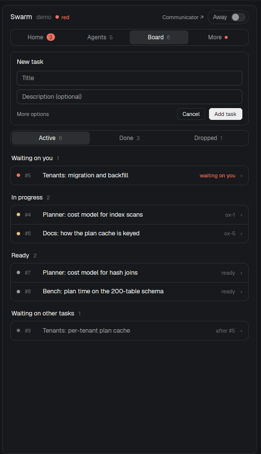
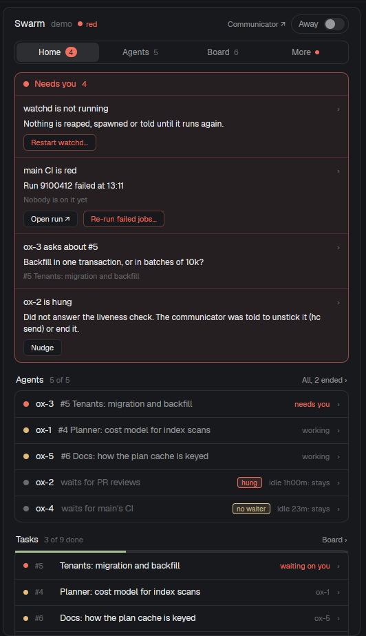
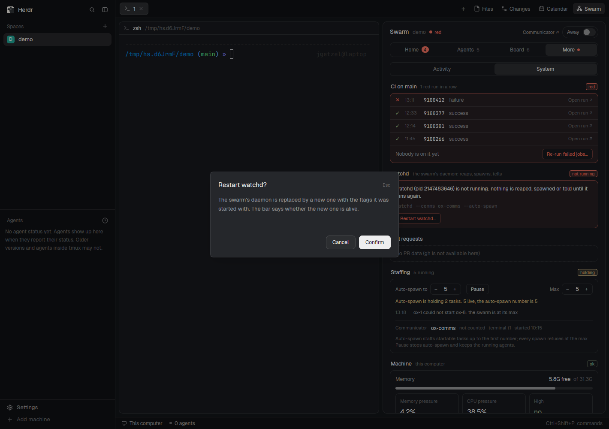

## 4. Away

Swarm has no away today. Proposal:

```
swarm away [note]     # "I'm gone": sets the flag, logs an `away` event
swarm away --back     # clears it, prints what waits and what happened meanwhile
```

While away:

1. **Questions queue instead of pinging.** `swarm task block` still records the question and the task
   still shows under Needs you. watchd does not send the communicator its urgent "X is blocked on #N"
   message, and `task block` tells the agent: "the user is away; park this and take work that doesn't
   need the answer". A prompt in an agent's terminal is handled the same way.
2. **The communicator is told once**, and reminded by its nudge on `read`/`wait`/`board`: "the user is
   away since 12:25: don't ask them; decide what is yours to decide, queue the rest".
3. **Work continues.** Auto-spawn keeps staffing up to your number, the max still caps, a red main
   still becomes a task. Being away changes who gets asked, not how much runs.
4. **On return** (`--back`, or the switch): one urgent message to the communicator, "the user is back:
   N questions wait", and the command's output (also a card on Home until dismissed) lists the
   questions oldest first, tasks finished and PRs merged meanwhile, main's CI state, agents that ended or hung.

Not proposed: answering for you, going away by itself after idle time, or changing the staffing numbers.

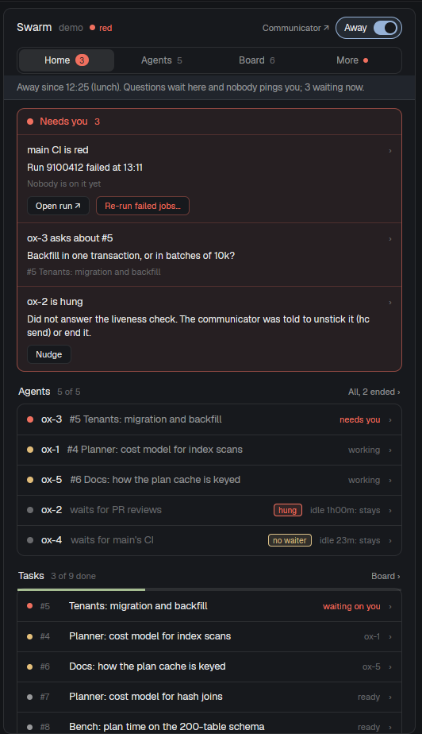
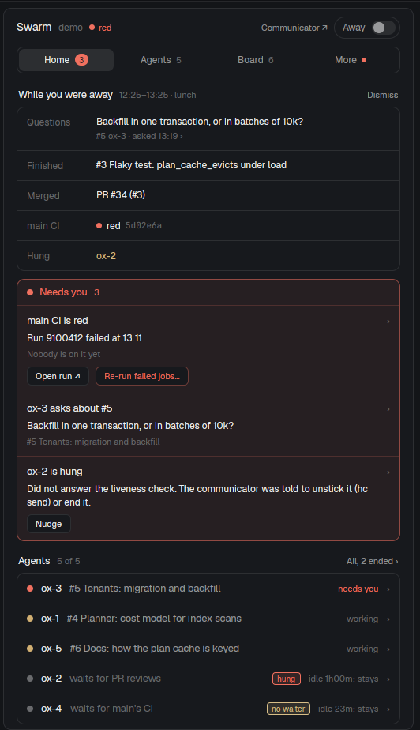

Cost: rule 1 changes a transition `swarm/model` covers (a block reaching the communicator), so the
model and its replay traces are updated with it. `away`, `--back` and the new rights get CLI tests.

## 5. Look

- One type scale: 16 a screen's title, 14 the header, 12.5 rows, 11 meta. No all-caps labels on the new screens.
- 16px gutters, 10px between sections. Rows sit in one bordered card with hairlines between them,
  instead of a bordered card per row.
- Color only where it means something: the status dot, Needs you (the theme's `blocked`), amber warnings
  (`ansi3`), green done (`ansi2`), the Away switch (`accent`). Everything else is foreground/muted/dim.
- Motion is native: a screen slides in 20px over 200 ms, the working dot pulses, the Away knob and context
  bar ease. No redraw timers; the two data timers are the old ones.
- Content is capped at 720px and centered on the detail screens.

## 6. What the prototype already does, and what the build adds

Real now: the nav bar, every screen and its navigation, the limit steppers, the confirm dialogs, the
refusal bar, the "why it is still here" section (drawn from `fate`, which no CLI sends yet),
`swarm state --json --task N` (body, events, messages of one task), a bare `swarm away` flag that the
switch toggles. Nothing else in the CLI is touched until you approve.

Build, after approval, as board tasks:

1. **CLI: rights and away.** `human` rights for `end` and `task release`, the message to the ex-owner,
   away's four rules, `--back`'s digest, tests, `swarm/model` for away's rule 1.
2. **CLI: state and the new commands.** `fate`, `ci`, `watchd` in `state --json`; `nudge`; `stay --end`
   for another agent; `watchd --restart`; tests.
3. **Panel.** The actions of §3b you keep, the text input, the "while you were away" card, Activity and
   System in the new scale, delete the old tabs' leftover code, shots of every screen at 420/520/860 in
   dark and light, actions exercised against a scratch db, `SKILL.md`, `install.sh` check, then merge.

## 7. Questions for you

Still open from revision 1 (the communicator recommends yes to all three; you have not said):

1. **Away**: are the four rules right? In particular rule 3 (work continues at your numbers).
2. **Answer from the panel**: a text field on a waiting task that runs `swarm task unblock N --answer "…"`. Add it?
3. **Acting as `human`** with the communicator's rights: fine, or should the panel act as the communicator?

New:

4. **§3b**: which of the "Add" rows do you want, and do you agree with the four I would leave out
   (@all, spawn on a task, free a lock, renew/claim)?
5. **Restart watchd** from the panel: wanted? It is the one row that restarts the swarm's own daemon.
6. **Why it is still here**: always open on an idle agent's screen (as drawn), or folded behind a click?

## 8. Approved (2026-11-11) and how the build is split

The user approved revision 2 through the communicator. Their answers, which override the text above where they differ:

1. Away: yes, the four rules as written.
2. Answer field on a waiting task: **not in this build.** Keep the hint text on the question card.
3. Act as `human` with the communicator's rights. If that turns out hard, say so before falling back to acting as the communicator.
4. Build every "Add" row of §3b except the answer field: nudge, message an agent, add task, drop task, pause/resume
   auto-spawn, open and re-run failed CI, watchd health, main's CI dot, communicator link, end another agent's stay.
   The four "Leave out" rows stay out.
5. Restart watchd: yes, with its confirmation and the recorded flags, and never leaving the repo without a watchd:
   verify the new one is alive before reporting success; if it is not, say so in the bar.
6. "Why it is still here" is always open on an idle agent's screen.
7. When done, swap over: the redesigned mod replaces the installed one (install.sh path and the user's live Herdr).

The build lands on the branch **`swarm-panel`** (it holds this doc, the shots and the prototype), then one PR
takes `swarm-panel` to main. Nothing from it is on main before that, so the installed panel keeps working.

How it was checked: `herdr-app check`, the shots, and each action clicked in `shot.sh`'s private display
(`--before`, xdotool) against a copy of the fixture's board, reading the bar and the board afterwards.
