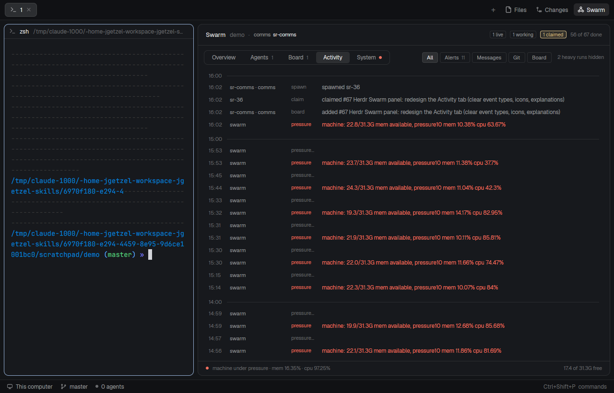
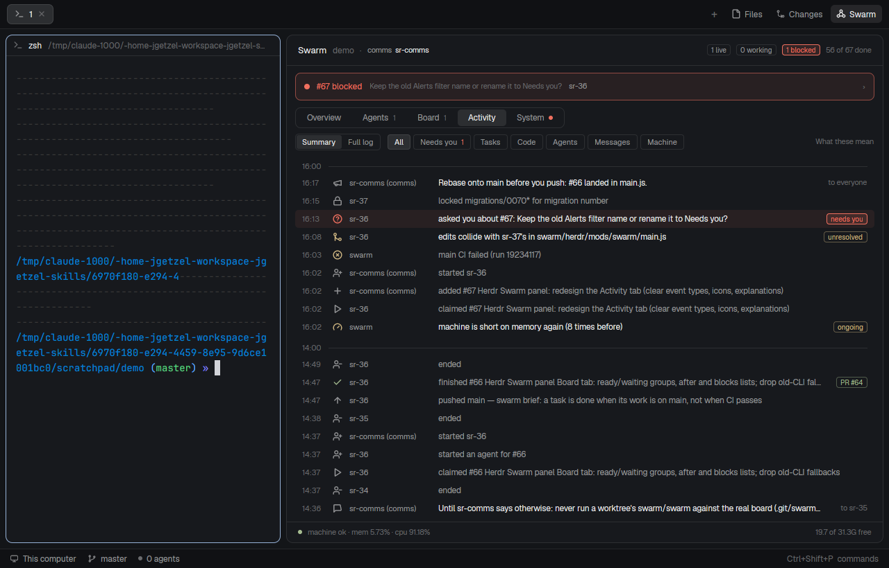
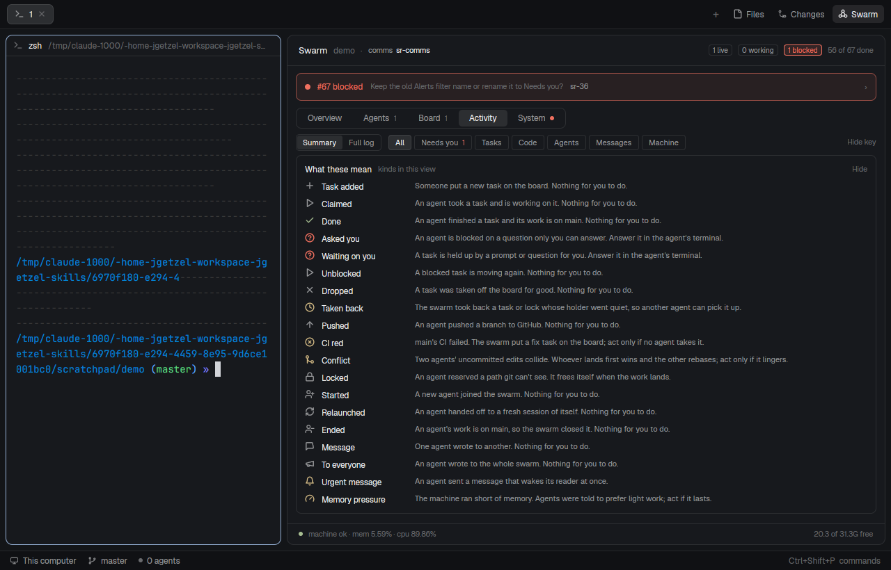
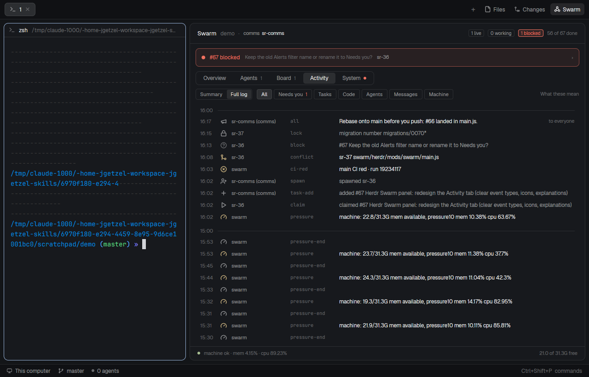
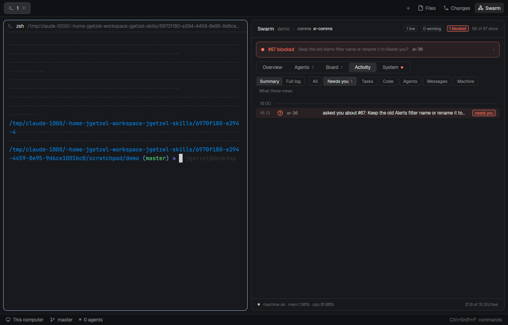
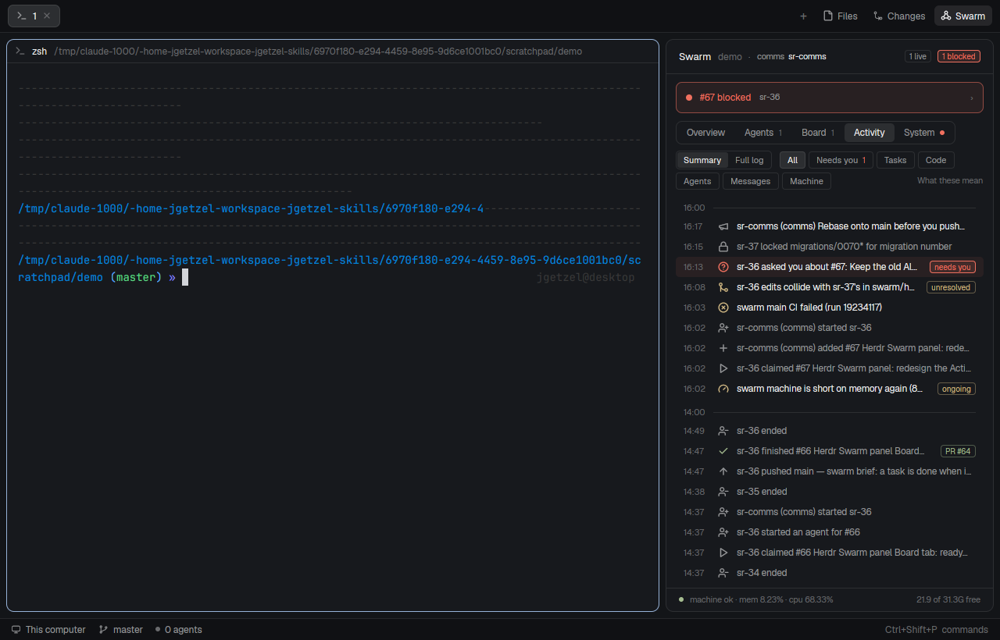
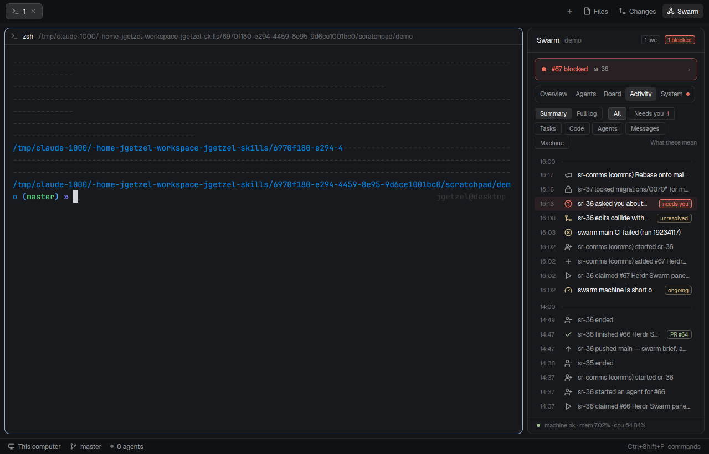
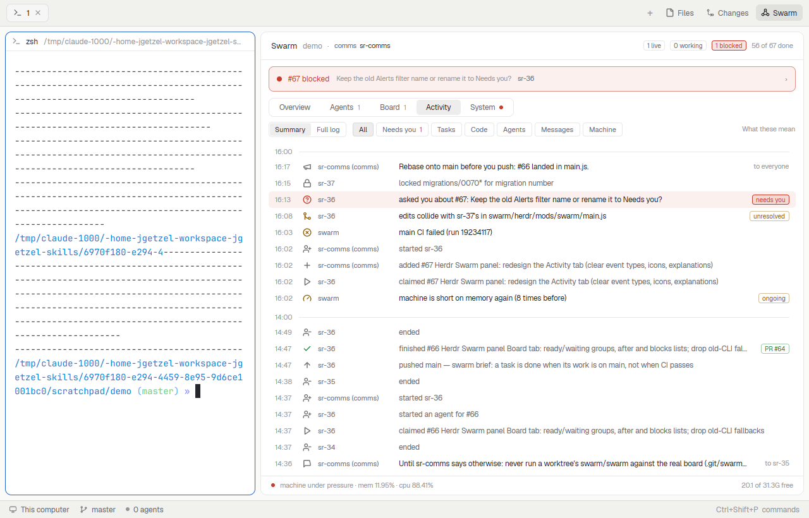

# Activity tab: event kinds, icons, explanations (board task #67)

The Herdr Swarm panel's Activity tab listed every event as `time · who · kind · raw data`, with
anything "alert-like" in red. On a real board that meant a wall of red `pressure` / `pressure-end`
pairs, kind names cut off at 54 px (`pressure…`), raw data such as `#64 PR #63 merged: …`, and no way
to tell what a kind means or whether you need to act.

## What Herdr can draw

- `svg(path)`: a one-color icon tinted with the text color (Herdr's own mods use Lucide).
- `.tooltip(text)` on a `div`/`h_flex`/`v_flex`: a string label after a 0.5 s hover. No rich content.
- `svg()` refuses a path that resolves outside Herdr's home, and `mods/swarm` is a symlink into the
  repo, so the panel copies `mods/swarm/icons/*.svg` to `~/.config/herdr-app/swarm-icons/` on start.
  Until that copy lands (or if it fails), an icon is an empty box of the same size.
- Herdr's JS engine is far slower than node: a frame that builds the event list twice overruns its
  budget ("This view could not be re-rendered … interrupted"). The list is built once per snapshot.

## The design

Two views, chosen at the left of the filter row: **Summary** (the new default) and **Full log**.

**Summary.** One plain sentence per event with an icon for its kind: "sr-36 claimed #67 Herdr Swarm
panel…", "sr-36 finished #66 … [PR #64]", "sr-comms added 2 tasks: #62 and #63". Color only means
something:

| color | means | example |
|---|---|---|
| red, row tinted, `needs you` chip | waiting on you right now | an agent asked you a question |
| dim, `answered` | it waited on you, and no longer does | the same question, after you answered |
| yellow | a problem the agents or swarm handle; `unresolved` / `ongoing` while it lasts | conflict, CI red, memory pressure |
| green | something finished | done, CI green again |
| grey | routine | claimed, pushed, started, ended |

Folding: a post fanned out to N agents is one row; a memory-pressure episode is one row, and episodes
back to back with nothing in between are one row ("machine was short on memory 6 times, up to 1m
each"); runs within two minutes of agents starting, agents ending, tasks added and tasks dropped fold
into one row. Routine bookkeeping (wakes, nudges, heavy runs, lease notes, unlocks, compactions,
joins, swarm notices) is left to the full log.

**Full log.** Today's view: every event and message `state --json` sent, unfolded, with its raw kind
in mono, now with the same icons.

**Explanations.** Every row's tooltip says the kind's name, what it means and whether you act
(folded rows add each event they hold; long rows add their full text). "What these mean" at the end
of the filter row opens a key of the kinds in the current view.

**Filters** (both views): All, Needs you (count in red), Tasks, Code, Agents, Messages, Machine.

**Widths.** The filters always get their own row on Activity. ≥ 760: who column 118 px; 640 to 760:
80 px; below 640 who joins the sentence; below 520 the tail (message recipient) drops, chips stay;
at 320 the filters wrap to three rows. **Themes:** theme tokens only (`blocked`, `ansi3`, `ansi2`,
`muted`, `dim`), checked in graphite (dark) and paper (light).

**Data.** `state --json --view activity` reads the last 300 events and 120 messages (other views keep
60 and 40), since the summary hides most of them.

## Every kind

S = shown in Summary, L = Full log only. Message kinds come from `msg.kind`/`urgent`.

| group | kind | icon | label | what it means / do you act | level | view |
|---|---|---|---|---|---|---|
| tasks | task-add | plus | Task added | Someone put a new task on the board. No. | | S |
| tasks | claim | play | Claimed | An agent took a task. No. | | S |
| tasks | done | check | Done | An agent finished a task; its work is on main. No. | good | S |
| tasks | block | circle-help | Asked you | An agent is blocked on a question only you can answer. **Yes.** | you | S |
| tasks | task-blocked | circle-help | Waiting on you | A task is held up by a prompt or question for you. **Yes.** | you | S |
| tasks | unblock | play | Unblocked | A blocked task is moving again. No. | | S |
| tasks | release | undo | Released | A task went back to the board. No. | | S |
| tasks | drop | x | Dropped | A task was taken off the board. No. | | S |
| tasks | reap | clock | Taken back | The swarm took back a quiet holder's task or lock. | warn | S |
| tasks | lease-late | clock | Lease late | An idle agent holds a task past its lease; the comms was told. | | L |
| tasks | task-after | link | Order set | A task waits for others first. | | L |
| tasks | startable | info | Startable | Older swarms only. | | L |
| code | push | arrow-up | Pushed | An agent pushed a branch. No. | | S |
| code | ci-red | circle-x | CI red | main's CI failed; a fix task is on the board. Only if nobody takes it. | warn | S |
| code | ci-green (swarm's `done` with "green run") | circle-check | CI green | main passed again. | good | S |
| code | conflict | git-merge | Conflict | Two agents' uncommitted edits collide. Only if it lingers. | warn | S |
| code | conflict-compat / -stale / -error | git-merge | … | Merges cleanly / behind main / check failed. | | L |
| code | overlap | triangle-alert | Overlap | Older swarms only. | warn | L |
| code | lock | lock | Locked | An agent reserved a path git can't see. | | S |
| code | unlock | lock-open | Unlocked | A lock was freed. | | L |
| code | deny-lock | ban | Edit refused | An edit to a locked path was stopped. | | L |
| code | lock-violation | triangle-alert | Lock broken | An agent edited another's locked path; both were told. | warn | S |
| code | shared-tree | users | Shared worktree | Two agents edit in one worktree; both were told. | warn | S |
| code | sweep | trash | Worktree removed | A finished agent's worktree was cleaned up. | | L |
| agents | spawn | user-plus | Started | A new agent joined. No. | | S |
| agents | join | log-in | Joined | An agent registered. | | L |
| agents | takeover | refresh | Relaunched | An agent handed off to a fresh session. No. | | S |
| agents | blocked | circle-help | Waiting on you | An agent is stopped at a prompt in its terminal. **Yes.** | you | S |
| agents | end | user-minus | Ended | An agent's work is on main; the swarm closed it. No. | | S |
| agents | leave / compact / ctx-note / fenced | log-out / shrink / gauge / ban | … | Bookkeeping. | | L |
| messages | msg (dm) | message | Message | One agent wrote to another. | | S |
| messages | all | megaphone | To everyone | An agent wrote to the whole swarm. | | S |
| messages | urgent | bell | Urgent message | A message that wakes its reader at once. | warn | S |
| messages | notice (system, notice) | info | Swarm notice | The swarm told an agent something on its own. | | L |
| messages | wake / digest / deny-cold | bell / info / ban | … | Bookkeeping. | | L |
| messages | post | – | – | The message row stands for it. | | – |
| machine | pressure (+ pressure-end) | gauge | Memory pressure | Low memory; agents prefer light work. Act if it lasts. | warn | S |
| machine | orphan-kill | zap | Process stopped | The swarm stopped a heavy process an agent left. No. | warn | S |
| machine | heavy-start / job-start / job-end / remote-clean | cpu / trash | … | Builds and tests, here or remote. | | L |
| – | anything else | dot | Other | No description yet. | | L |

`touch`, `status` and `heavy-count` never reach the panel (`state --json` leaves them out).

## Mocks

Real board copy (`.git/swarm/swarm.db` copied, read through `SWARM_DB`-free `state --json` in a
scratch repo), shot in a separate Herdr window and hc session. Five rows are staged in that copy to
show the states it lacked: #67 blocked with a question (and its `block` event), a conflict, a CI red
run, a lock and a broadcast message.

| Summary, 860 | Key open |
|---|---|
|  |  |

| Full log, 860 | Needs you filter, 640 |
|---|---|
|  |  |

| 420 | 320 | Light (paper), 860 |
|---|---|---|
|  |  |  |

## Open questions for the user

1. Summary as the default view, Full log one click away: right?
2. CI red and conflicts are yellow (agents handle them) rather than red; red is kept for "waiting on
   you". The needs-you strip above the tabs still shows a red main CI in red. Right?
3. The Overview's activity card now uses the same summary rows and icons. Keep?
